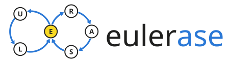
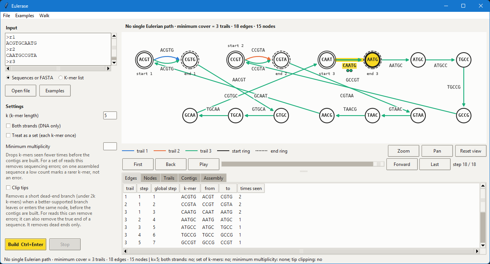

<p align="center">
  <picture>
    <source media="(prefers-color-scheme: dark)" srcset="docs/assets/eulerase-logo-dark.svg">
    
  </picture>
</p>

<p align="center"><strong>Learn and explore de Bruijn graphs, one step at a time.</strong></p>

<p align="center">
  <a href="https://github.com/pterw/eulerase/actions/workflows/gates.yml"></a>
  
  <a href="LICENSE"></a>
  
</p>

Eulerase is a desktop and command-line tool for learning and exploring de Bruijn graphs. Given
sequences and a k, it:

1. builds the de Bruijn graph (nodes are (k-1)-mers, edges are k-mers);
2. finds a minimum set of Eulerian trails that uses every edge once, and lets you step through the
   walk;
3. assembles contigs from the graph, with every simplification visible and chosen by you.

It is for students, teachers and bench biologists working with short sequences: a few reads typed
by hand, a gene, a plasmid, a phage or a mitochondrial genome. It is not a production assembler;
the sizes it accepts are in [Limits](#limits).

## What it claims

Three claims are kept apart, in the code, the labels and this file:

1. A trail is correct for the graph: it uses each edge once and spells a string whose k-mers are
   those edges.
2. A contig is a valid path in the assembly graph built from the k-mers given.
3. A sequence exists in an organism.

Eulerase makes the first two and never the third. A contig is not a validated assembly.

## What it does not do

Eulerase shows what is in the sequences it is given. It never reads genotype files, never looks up
variant identifiers, and never interprets a result for a person.

## About the name

The name is Euler plus "-ase". The mark above is the de Bruijn graph of the word EULERASE at
k = 2: its nodes are the word's letters and its edges are the word's seven 2-mers, EU UL LE ER RA
AS SE. The left loop is E-U-L-E and the right loop is E-R-A-S-E.

An Eulerian circuit of that graph, read from E, spells the word. From E there are two, EULERASE and
ERASEULE. Eulerase prints the circuit read from A, `ASEULERA`, which is the same loop. To print it:

```
eulerase --kmers "EU UL LE ER RA AS SE"
```

```
Eulerian circuit · 7 edges · 6 nodes
Note: GC and ORFs are not available because the input holds letters other than A, C, G, T and N: E, L, R, S, U.
trail 1 (7 edges): ASEULERA
```

## Install and check

Python 3.13 or later is required. Eulerase is run from a clone of this repository; nothing is
uploaded to a package index. From the clone, in a virtual environment:

```
python -m pip install -e ".[dev]"
```

The quotes around the extras keep the shell from treating `[dev]` as a pattern. This installs the
`eulerase` command. The three gates then run in this order, from the repository root:

```
python -m pytest -q -p no:cacheprovider
python -m ruff check .
python tools/check_fresh_export.py
```

The third command runs the tests again on a copy of the tracked files, importing the package from
that copy, with nothing untracked in reach, so a test that passes only because of the local setup
fails there. Stage a new file before running it.

Type `eulerase` to open the window, or `eulerase --seq LEMONLEMONADE` to run the command line, as
the examples below do.

A release of the package carries a source distribution and a wheel. The release workflow makes it
when a change merged into `main` carries a version that has no tag yet; see
[CONTRIBUTING.md](CONTRIBUTING.md#releases).

## The window

`eulerase` with no arguments opens the window. `eulerase --gui` with an input (`--seq`, `--kmers`
or `--file`) and any of the settings below opens the window with that input loaded and built; the
output options (`--figure`, `--csv`, `--gfa`, `--contigs`, `--genbank`, `--metrics`) cannot be used
with `--gui`, because the window has its own exports. A window opened with nothing loaded builds
the first example.



The layout:

- **Left.** The input box and the settings. The input box holds sequences or FASTA, or a k-mer
  list, as the two mode choices under it say. It does not wrap: a line longer than the box is scrolled
  sideways. The settings are k, both strands (DNA only), treat as a set (each k-mer once), minimum
  multiplicity and clip tips, the same as the command-line options below. The k box is off for a
  k-mer list, whose k is taken from the k-mers. Under the input box are the Open file and Examples
  buttons. Build and Stop sit at the foot of the sidebar; when the form is taller than the space it
  has, the form scrolls and they stay in view.
- **Centre.** The graph, with a strip under it that holds the legend and the view controls (Zoom,
  Pan and Reset view; the mouse wheel zooms), and under that the step controls: First, Back, Play
  (it reads Pause while playing), Forward and Last, a scale, and a label that reads "step N / N".
- **Divider.** A divider between the graph and the tables can be dragged to give either more room.
- **Tables.** Five tabs: Edges, Nodes, Trails, Contigs and Assembly. Selecting a row of the Edges
  table moves the walk to that step. The Assembly tab shows the measures, with the settings, the
  ORF rule and the notes as text under them, and the k-mer spectrum chart beside them.
- **Status bar.** Messages along the bottom, and a busy indicator while a build runs.
- **Menus.** File, Examples and Walk. Exports are in the File menu, and are off until a build has
  succeeded.

Build is Ctrl+Enter, Stop is Esc, and Ctrl+Q quits.

The Examples menu offers eight inputs, each with its own k and settings:

1. Lemon text, k=3 (single path)
2. DNA with a repeat, k=4
3. Tandem repeat (self-loop), k=3
4. Two unrelated reads (2 trails), k=4
5. Both strands, k=5
6. A k-mer list that closes into a circuit
7. Overlapping reads (assembly), k=5
8. Reads with one error, tip clipping on, k=4

A build can be stopped with Stop (the button, or Esc): the window then shows no result, and says
"Stopped." Starting a new build abandons the one in progress. After a failed or stopped build,
nothing from an earlier build stays on screen or can be exported. When a build would make more than
100,000 k-mers, the window asks before it starts, and runs the build in a separate process that
Stop, a new build or closing the window ends. Above the k-mer limit in the table below, the build
is refused without a question.

When this Python has no tkinter, the command prints one line, and the command-line options still
work:

```
eulerase: The window needs tkinter, which this Python does not have; the command-line options still work.
```

## The command line

`eulerase` with an input prints the headline, any notes and the trails, and writes the files asked
for.

Input, one of:

- `--seq SEQ [SEQ ...]`: one or more sequences.
- `--kmers KMER [KMER ...]`: a list of k-mers, all one length.
- `--file PATH`: a FASTA, FASTQ, GenBank or EMBL file, plain or gzip.

Settings:

- `-k INT`: k-mer length for `--seq` and `--file`, at least 2 (default 3). With `--kmers`, leave
  `-k` out: it is taken from the k-mers.
- `--both-strands`: also use the reverse complement of every sequence (DNA only; default off).
- `--unique`: treat the input as a set: keep each distinct k-mer once (default off).
- `--min-count N`: drop k-mers seen fewer than N times before the contigs are built (default: keep
  all).
- `--clip-tips`: before the contigs are built, remove short dead-end branches (under 2k k-mers)
  when another branch from the same node is seen more often on average (default off).

Output:

- `--figure PATH`: write the graph as a png, svg or pdf figure.
- `--csv PREFIX`: write the tables as `PREFIX_<table>.csv` files, one per table, each holding every
  row.
- `--gfa PATH`: write the contigs as a GFA 1.0 file, linked by the (k-1)-letter overlap; a cycle's
  one link, to itself, reads `0M`.
- `--contigs PATH`: write the contigs as a FASTA file, one record for each contig; its description
  holds the settings and the ORF count.
- `--genbank PATH`: write the contigs as a GenBank file.
- `--metrics`: print the assembly measures.

And `--gui`, which opens the window with the input loaded. Every option that acts on an input is an
error without one, two inputs together are an error, and `-k` with `--kmers` is an error.
`eulerase --help` lists them all.

The exit status is 0 when the command succeeded, 1 when an input or an output failed, and 2 when
the options were wrong. A failure is one sentence on standard error that says what was wrong and
what to do, never a traceback.

### Examples

A typed sequence, with letters that are not DNA:

```
eulerase --seq LEMONLEMONADE
```

```
Eulerian path · 11 edges · 8 nodes
Note: GC and ORFs are not available because the input holds letters other than A, C, G, T and N: D, E, L, M, O.
trail 1 (11 edges): LEMONLEMONADE
```

Two reads that share no k-mer need two trails:

```
eulerase --seq ACGTACGGA TTGCCATTA -k 4
```

```
No single Eulerian path · minimum cover = 2 trails · 12 edges · 13 nodes
trail 1 (6 edges): ACGTACGGA
trail 2 (6 edges): TTGCCATTA
```

A list of k-mers that closes into a circuit:

```
eulerase --kmers ACG CGT GTA TAC
```

```
Eulerian circuit · 4 edges · 4 nodes
Note: A contig marked as a cycle is a closed path in the graph: it can be a circular molecule or a repeat, and its position 1 is its alphabetically first rotation, not a biological start.
trail 1 (4 edges): ACGTAC
```

A file. With `reads.fasta` holding

```
>r1
ACGTACGT
>r2
TTGCAACG
```

the command is:

```
eulerase --file reads.fasta -k 3
```

```
No single Eulerian path · minimum cover = 2 trails · 12 edges · 9 nodes
trail 1 (2 edges): ACGT
trail 2 (10 edges): TTGCAACGTACG
```

Both strands:

```
eulerase --seq ACGTTGCAACGTTGCA -k 4 --both-strands
```

```
No single Eulerian path · minimum cover = 2 trails · 26 edges · 8 nodes
Note: Both strands: reported one contig per strand pair (the smaller strand in string order is kept, which may be the reverse complement of the input).
Note: A contig marked as a cycle is a closed path in the graph: it can be a circular molecule or a repeat, and its position 1 is its alphabetically first rotation, not a biological start.
trail 1 (5 edges): ACGTTGCA
trail 2 (21 edges): TGCAACGTTGCAACGTTGCAACGT
```

The assembly measures:

```
eulerase --seq ACGTTGCAACGTTGCA -k 4 --metrics
```

```
Eulerian path · 13 edges · 8 nodes
Note: A contig marked as a cycle is a closed path in the graph: it can be a circular molecule or a repeat, and its position 1 is its alphabetically first rotation, not a biological start.
trail 1 (13 edges): ACGTTGCAACGTTGCA
contigs: 1
total length: 8
longest: 8
shortest: 8
mean length: 8.0000
n50: 8
l50: 1
n90: 8
gc: 0.5000
mean multiplicity: 1.6250
distinct k-mers: 8
total k-mers: 13
removed k-mers: 0
clipped branches: 0
clipped k-mers: 0
settings: k=4; both strands: no; set of k-mers: no; minimum multiplicity: none; tip clipping: no
orf rule: ORFs: start codon ATG, standard genetic code, at least 25 amino acids, the longest per stop codon, ending in a stop codon (none read off an end or across a codon with N); an ORF is a reading frame, not evidence of a gene.
contig 1 length 8 multiplicity 1.6250 cycle yes
```

Files: the figure, the five tables as CSV files, and the contigs as GFA, FASTA and GenBank:

```
eulerase --seq ACGTTGCAACGTTGCA -k 4 --figure graph.png --csv tables --gfa assembly.gfa --contigs contigs.fasta --genbank contigs.gbk
```

```
Eulerian path · 13 edges · 8 nodes
Note: A contig marked as a cycle is a closed path in the graph: it can be a circular molecule or a repeat, and its position 1 is its alphabetically first rotation, not a biological start.
trail 1 (13 edges): ACGTTGCAACGTTGCA
Wrote graph.png
Wrote tables_edges.csv
Wrote tables_nodes.csv
Wrote tables_trails.csv
Wrote tables_contigs.csv
Wrote tables_assembly.csv
Wrote assembly.gfa
Wrote contigs.fasta
Wrote contigs.gbk
```

An input that fails (exit status 1):

```
eulerase --seq ACGT -k 1
```

```
eulerase: k must be a whole number of at least 2, not 1; give a larger k.
```

Options that are wrong (exit status 2):

```
eulerase --kmers AC AG -k 3
```

```
eulerase: -k cannot be used with --kmers: leave -k out, the length is taken from the k-mers.
```

## Limits

Three limits are named in the code. Each is stated here with what happens above it.

| Limit | Value | Above it |
|---|---|---|
| k-mers accepted | 300,000 | The input is refused before any work, with the limit in the message. With both strands, both strands' k-mers count. |
| Drawing | 400 nodes, or 2,000 arrows | The tables are shown, and the figure says why it is empty and which count was over. Arrows are the walk graph's edges, self-loops and parallel edges included. |
| Table rows shown | 2,000 | The table says how many rows it shows of how many ("Showing 2000 of N rows."). An export always carries every row. |

Two numbers are not limits. The shortest ORF counted is 25 amino acids long, and the default k is 3.

## What a multiplicity is

Eulerase keeps two views of the same k-mers. The walk graph has one edge for each occurrence of a
k-mer in the input, and is used for the trails and the step-through. The assembly graph has one edge
for each distinct k-mer, with the number of times it was seen, and is used for the contigs, the
measures, the k-mer spectrum and the GFA file.

The number attached to a k-mer is its multiplicity: how many times it occurs in the input, and
nothing more. Ten reads of one molecule and one sequence with a tenfold repeat give the same
number, and Eulerase cannot tell which it was given. So labels say "multiplicity" or "times seen",
and no output presents it as a copy number or as evidence of anything in an organism.

The two filters act on these counts, and they are the only simplifications Eulerase offers. Both
are off by default, so by default the graph and the contigs reflect exactly the k-mers given.

- **Minimum multiplicity** (`--min-count N`) removes the distinct k-mers seen fewer than N times
  from the assembly graph, and the result says how many. It is applied first. The walk graph is
  never filtered.
- **Tip clipping** (`--clip-tips`) removes short dead-end branches from the assembly graph, and the
  result says how many k-mers and branches it removed. It removes dead ends, not bubbles.

These act as error filters only when the input is a set of reads. On one assembled sequence, a low
count marks a rarer k-mer, not an error, and tip clipping can remove the true end of the sequence.

## Contigs, ORFs and GC

A contig is the path through the assembly graph that the k-mers give. A contig marked as a cycle is
a closed path in the graph: it can be a circular molecule or a repeat. An isolated cycle of n
distinct k-mers gives a contig of exactly n letters, written once, and its position 1 is its
alphabetically first rotation, not a biological start.

The Contigs table has these columns: contig, length, edges, k-mer count, mean multiplicity, min
multiplicity, gc, orfs, cycle, has n and strand.

The ORF rule is the sentence the tool prints with the measures:

> ORFs: start codon ATG, standard genetic code, at least 25 amino acids, the longest per stop codon,
> ending in a stop codon (none read off an end or across a codon with N); an ORF is a reading
> frame, not evidence of a gene.

A contig marked as a cycle is read around the circle, so an ORF may cross position 1. The `orfs`
column counts the ORFs found on that contig by this rule, on both of its strands. GC is computed
over A, C, G and T, with N left out. GC and ORFs are not available, and the output says so, when
the input holds letters other than A, C, G, T and N.

## Files written

The GenBank file is for viewers, not for submission. The writer sets its date field to a fixed
value, `01-JAN-1980`, so that files are byte-identical across runs.

## Determinism

The same input and settings give the same trails, contigs, numbers and ordering. The text outputs,
which are the CSV, GFA, FASTA and GenBank files and what the command prints, are identical from run
to run: written as UTF-8 with `\n` line endings, in a fixed order, and with nothing taken from the
clock, the host or a path. Node coordinates are identical for the same input and the same canvas
shape. The bytes of an image file are not promised.

## Status

The Windows executable is not built, so the tool is run from a clone, as described above.

## Licence

MIT. See [LICENSE](LICENSE).

## Where to go next

- [CONTRIBUTING.md](CONTRIBUTING.md): setup, the gates, commits and pull requests.
- [AGENTS.md](AGENTS.md): the rules an agent or model follows when it works on the repository.
- [CHANGELOG.md](CHANGELOG.md): the changes of each release.
- [SECURITY.md](SECURITY.md): how to report a vulnerability.
- [LICENSE](LICENSE): the licence.
